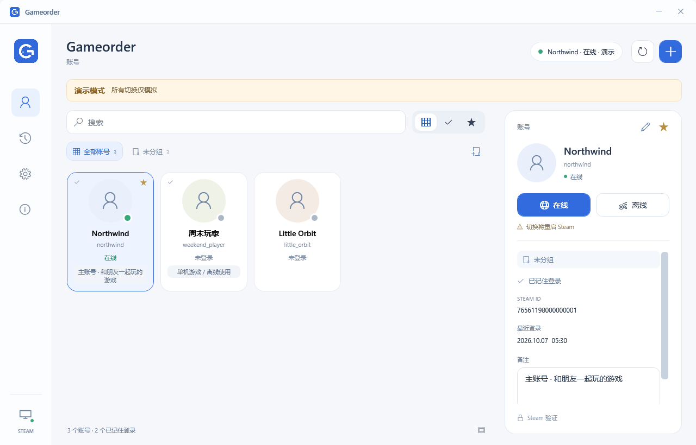
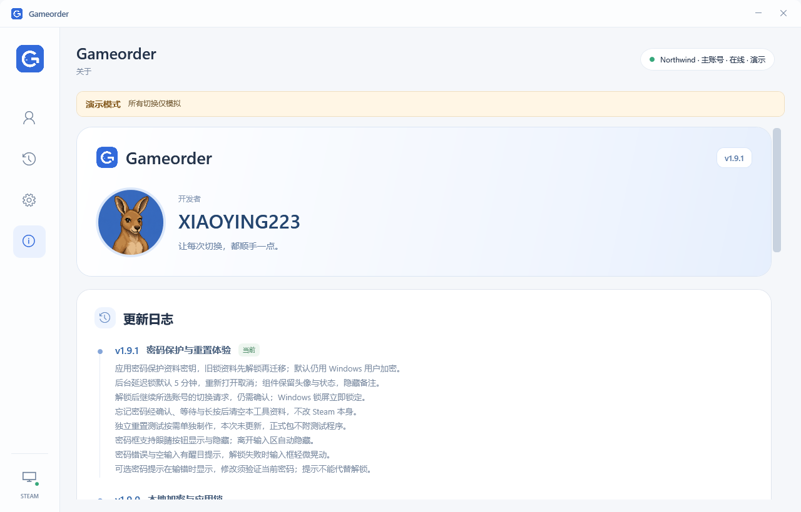
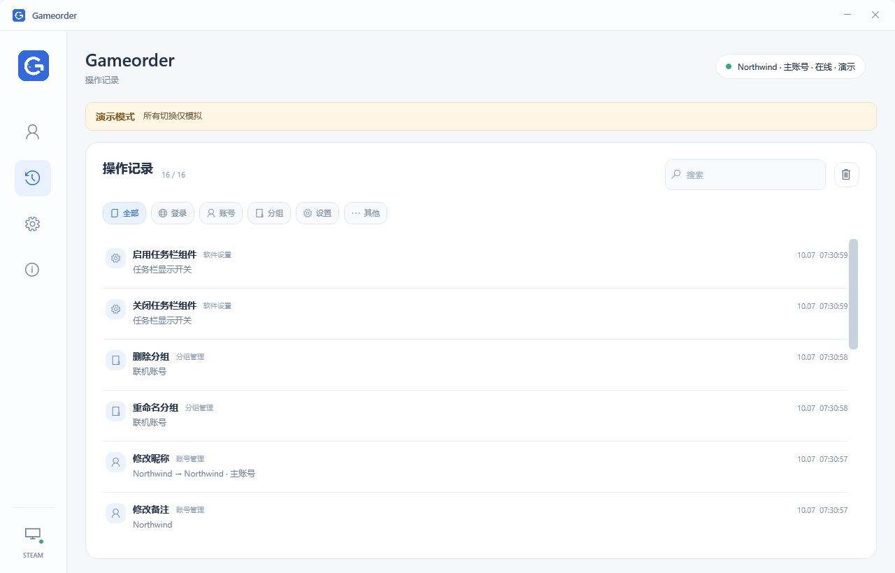

# Gameorder


让 Steam 多账号管理更顺手。Windows 桌面工具，使用头像卡片管理账号，通过任务栏小组件快捷切换。

**版本：1.9.1 · 作者：XIAOYING223 · Vibe Coding**

[下载最新版](https://github.com/geovanyl7289-maker/Gameorder/releases/latest) · [使用说明](使用说明.md) · [安全说明](SECURITY.md) · [GPL-3.0-only 许可证](LICENSE)

本仓库公开当前版本的完整应用源码、测试与构建脚本，支持检查实现和自行构建。旧版源码快照见 [HISTORY](HISTORY.md)。

## 功能

- 头像网格、备注、收藏与搜索，一眼找到目标账号。
- 软件内账号分组；添加账号、编辑昵称和备注、移出账号库。
- 在线／离线启动，并显示本机 Steam 当前账号、会话状态与正在运行的游戏。
- 任务栏小组件：直接预览账号、展开头像栏并发起切换。
- 游戏运行时减少后台活动，暂时隐藏任务栏组件；绿色托盘图标显示优化状态，结束后自动恢复。
- 操作记录覆盖账号、备注、分组、导入、设置与切换，支持筛选、搜索和确认后清除。
- 在设置中开关小组件；拖动至「左侧」或「托盘侧」，靠近落点时显示同尺寸圆角虚线框。
- 自定义标题栏、紧凑圆角托盘菜单，以及包含作者头像和更新日志的「关于」页。
- 默认加密账号资料与操作记录；启用应用锁后由应用密码保护资料密钥，统一验证管理与切号入口。
- 可选后台锁定延迟，锁定后组件仍显示头像与状态，隐藏备注；解锁后继续所选账号的切换请求。
- 可选密码提示在输错时显示，修改提示需验证当前密码；忘记密码仍需明确确认后清空本工具资料。

## 界面预览

以下截图使用软件内的合成演示账号。







## 使用

从 [Releases](https://github.com/geovanyl7289-maker/Gameorder/releases/latest) 下载并解压 Windows x64 程序包，运行 `Gameorder.exe`。正式包包含 .NET 运行时；从源码构建的方法见下文。

1. 自动识别 Steam 路径；未识别时，在设置中选择 `steam.exe`。
2. 从 Steam 导入本机账号，或添加登录名作为待登录账号。
3. 选择头像，点击在线或离线操作，确认后由 Steam 完成登录。

切换会正常退出并重新启动 Steam，请先保存游戏进度。账号密码、Steam Guard 和首次授权都在 **Steam 官方窗口**中完成。离线模式要求该账号已在本机在线登录并保留有效登录缓存；失效授权和仅联网游戏仍需联网。

启动时自动确认本机 Steam 会话。绿色状态表示已确认在线；没有已确认在线账号时显示离线提示，保留账号头像和任务栏组件，账号库仍可管理。已确认的离线会话在顶部、账号卡片、快捷头像栏和任务栏入口显示「离线登录」；Steam 未运行时整体显示「离线」，状态详情保留等待登录或待确认等实际原因，不会把「有登录缓存」或「上次选择」直接当作在线。


Steam 离线缓存登录时，`ActiveUser` 可能为 0，且没有新的联网日志。1.8.3 新增已运行客户端当前本地用户的只读读取，不再只靠注册表或联网日志判断：`GetSteamID` 用于获取当前已登录账号，`BLoggedOn` 用于确认与 Steam 服务器的连接状态。查询不会启动 Steam、设置 AppId 或修改配置；接口不可用时退回其他本机证据，身份未知、证据不足或冲突时保留待确认。[Steam 当前用户说明](https://partner.steamgames.com/doc/api/ISteamUser#GetSteamID) · [Steam 连接状态说明](https://partner.steamgames.com/doc/api/ISteamUser#BLoggedOn)

关闭或最小化主窗口后，托盘和任务栏组件继续运行。完全退出请使用托盘菜单的「退出」。任务栏空位不足时组件会缩小；首选停靠位置不可用时使用另一处可靠空位，不修改保存的偏好。两处都没有可靠空位时暂时隐藏组件，也可从托盘打开头像栏。

更多操作见 [使用说明](使用说明.md)。

## 运行游戏与后台节能

游戏状态依据本机 Steam 当前账号的运行信息显示。游戏期间暂时隐藏任务栏小组件，托盘显示绿色优化图标，右键菜单提供「打开主界面」；需要完全退出时，可在设置中选择「退出应用」。游戏结束后，小组件按原来的开关与停靠位置恢复，用户手动关闭的组件仍保持关闭。

主界面与快捷面板都隐藏时，Gameorder 降低自身进程和内存优先级，并在系统支持时启用 EcoQoS。打开任一界面或正在切换时恢复交互策略；系统不支持 EcoQoS 时仍使用可用的降优先级策略。常规前台每 5 秒读取状态，常规后台每 15 秒读取，游戏期间每 20 秒读取。 EcoQoS 通过 Windows 的进程电源节流接口应用于 Gameorder 自身。[Windows SetProcessInformation 说明](https://learn.microsoft.com/en-us/windows/win32/api/processthreadsapi/nf-processthreadsapi-setprocessinformation)

游戏运行且两个界面都隐藏约 10 秒后，会卸载可重新创建的主界面视觉树、界面资源和头像内存缓存，断开旧控件的绑定和子节点。打开主界面时重新加载，保留同一账号库、选中页面、筛选和未保存备注草稿；快捷头像栏可单独打开。作者头像按显示尺寸解码。游戏暂停组件时销毁其自有任务栏子窗口，结束后按安全布局重新创建，保留组件开关与停靠偏好。

周期状态读取通过不重叠的后台任务完成，丢弃过期结果；状态未变时不重复刷新界面和托盘。任务栏布局通过定期读取重新确认，避免 UIA 事件订阅造成反复隐藏。无游戏的已确认离线会话仍显示组件；游戏监控更严格排除监控进程自身。

这些策略减少 Gameorder 自身的后台活动，并释放可重新创建的界面资源；Windows 的内存回收和统计有自己的时机，不保证任务管理器数值立即下降或固定下降比例。资源解绑不代表所有对象立即被回收；生产运行不强制垃圾回收，也不承诺固定 CPU 降幅或提升游戏帧率。游戏刚启动、退出或状态尚未确认时，显示可能稍有延迟。

## 操作记录与提示

「操作记录」保留账号、备注、分组、导入、设置与切换等操作。先按类型筛选，再输入关键词查找；清除按钮只处理当前筛选结果，并在删除前确认，不改变账号资料或设置。

成功与普通状态提示约 6 秒后自动消失，错误提示约 12 秒后消失。加载进度和需要确认的操作保持显示。

## 本机数据

| 内容 | 默认位置 |
| --- | --- |
| 昵称、备注、分组、收藏、任务栏偏好与操作记录 | `%LOCALAPPDATA%\FloatOrder\accounts.json` |
| 公开头像缓存 | `%LOCALAPPDATA%\FloatOrder\avatars` |
| 切换前的加密配置快照 | `%LOCALAPPDATA%\Gameorder\backups` |
| 应用锁、密码提示与资料密钥配置 | `%LOCALAPPDATA%\Gameorder\security.golock` |

`FloatOrder` 是兼容旧版本而保留的数据目录名。Gameorder 不收集密码或验证码，也不导出或迁移 Steam 认证令牌。

1.9.0 起，`accounts.json` 保存带版本标记的密文。1.9.1 未启用应用锁时继续使用当前 Windows 用户范围的 DPAPI；启用后，随机资料密钥（DEK）负责 AES-GCM 加密账号资料，应用密码经带随机盐的 PBKDF2-SHA256 派生密钥，再用 AES-GCM 包裹 DEK。安全配置外层仍由 DPAPI 保护，不保存应用密码原文。

旧明文资料与 1.9.0 DPAPI 资料在完整读取、验证后迁移；已有应用锁的旧资料需要先成功解锁，再迁移到新的密码保护格式。读取、解密或迁移失败停止覆盖，保留原文件或加密恢复材料。写入只使用密文临时文件与原子替换，不创建明文备份。

应用锁默认关闭，可在设置中自行设置应用密码。后台锁定延迟可选 **立即、1、3、5、10 分钟**，默认 **5 分钟**；0 表示立即锁定。关闭或最小化主窗口隐藏后才开始计时，重新打开取消后台倒计时，操作任务栏组件或快捷头像栏重新计时；Windows 锁屏立即锁定；进行中的切换先完成，再处理锁定。更改密码或关闭应用锁需要验证当前密码。

点击密码框旁的眼睛图标可显示／隐藏密码；离开输入区或窗口失焦时自动隐藏。

可在设置应用密码时填写可选提示，输错密码后自动显示。修改提示需要验证当前应用密码；提示只是线索，不能代替解锁，也不会增加加密强度。只写自己看得懂的线索，不填写密码原文。

锁定后主界面的账号管理、备注与记录不可操作，快捷管理与直接切号须先解锁。**任务栏头像、账号显示名和在线／离线状态保持可见，备注隐藏**，供辨认目标账号；点击切换可打开解锁界面，成功解锁后继续该账号的切换请求，仍需要最终切换确认。游戏期间组件依照原有游戏策略暂时收起。

忘记应用密码不能从程序中找回，删除 `security.golock` 也不是保留账号资料的恢复方法。可在锁定界面选择「忘记密码」，精确输入 **我已经确认**，等待 **15 秒**，再连续按住清空按钮 **3 秒**。提前松手、失焦、按 Esc 或取消会中止。最终确认后清空本工具的账号资料、备注、分组、记录、公开头像缓存和自生成的加密 Steam 配置备份，关闭应用锁并重建空库；自动 Steam 导入保持关闭，需用户主动并成功导入后再恢复。Steam 客户端自身的登录缓存与游戏不删除。

DPAPI 通常绑定当前 Windows 用户与电脑，应用密码不能消除这层绑定；换机、重装系统或丢失用户配置可能使密文无法解密。当前不提供跨电脑资料导出工具。**1.9.0 及更早程序不能读取 1.9.1 的密码保护资料格式**，回退前应理解格式变化。公开头像不受应用密码加密，Steam 配置备份继续使用 DPAPI；应用锁也不能锁住 Steam 本身或隔离同一用户的恶意程序、调试与内存读取。详见 [安全说明](SECURITY.md)。

头像优先使用 Steam 本机缓存；缺少时会通过账号的 SteamID 查询 Steam Community 公开资料并下载头像。请求不使用密码、令牌或登录 Cookie。服务限流或加载失败时保留缓存／占位，不阻止切换。使用 `Gameorder.exe --local-avatars` 可只加载本机头像。

切换备份由 Windows DPAPI 加密，同一 Windows 用户可在设置中恢复最近一次切换。Steam 未能正常退出、配置格式异常或配置被其他程序改动时，会停止修改或恢复并提示。

## 独立重置测试

独立测试程序按需单独制作，**本次未更新，也不附在本次正式包中**。以下说明保留已有测试机制；已有测试程序的默认密码为 **12345678**。

运行专用程序 `Gameorder-重置测试.exe`，或用普通程序的 `--reset-test` 参数进入测试模式。专用构建从编译时强制隔离，不需要记住参数；正式程序与测试程序可以同时运行。

测试只使用合成账号与 `%LOCALAPPDATA%\Gameorder\ResetTest` 下的独立资料，默认测试密码为 **12345678**。测试不会导入真实 Steam、查询网络头像、修改 Steam 注册表或挂载原生任务栏。显示的是复用真实控件的独立桌面预览窗口，用于体验锁定、解锁后切换与重置；它不是实际任务栏嵌入验证。

主窗口最小化或关闭后可从测试预览重新打开，预览的「退出测试」关闭测试实例。测试中的清空只处理测试目录；「重建测试数据」恢复合成资料和默认测试密码，并重新进入锁定状态；头像与状态可见，备注需解锁后加载，可反复体验。正式程序没有这个重建按钮。再次启动测试及其快捷命令只与测试实例通信，不能切换或退出正式实例。

## 开发与构建

当前应用源码位于 `src`，核心与安全测试位于 `tests`。以下命令在仓库根目录执行。

开发需要 Windows、.NET 9 SDK 和 Windows Desktop 开发支持。项目使用 WPF 与 Windows Forms，未依赖第三方 NuGet 包；首次构建仍可能需要恢复 Microsoft 的框架与运行时包。已提交应用图标与作者头像，无需先运行图标生成脚本。

```powershell
git clone https://github.com/geovanyl7289-maker/Gameorder.git
cd Gameorder
dotnet build .\src\Gameorder.csproj -c Release -p:ResetTestBuild=false
dotnet run --project .\tests\Gameorder.Tests.csproj -c Release
```

安全测试验证 DPAPI、密码保护资料、迁移、密码提示和隔离清空流程：

```powershell
dotnet run --project .\tests\security-storage\SecurityStorage.csproj -c Release
```

其中清空测试使用 `CreateTest` 的显式开发目录，源码将这些目录限制在 **`H:\Documents\Playground\` 下**。运行完整安全测试前，仓库及其构建输出须位于该目录内；仓库克隆到 C 盘等其他位置时仍可构建应用和运行核心测试，但部分安全清空测试会被路径保护拒绝。CI 使用 `subst` 映射 H 盘后运行验证，不通过放宽生产代码的清空范围来绕过限制。

发布 Windows x64 单文件程序，包含 .NET 运行时：

```powershell
.\Build.ps1 -SelfContained
```

输出位于 `dist\`。不加 `-SelfContained` 可生成依赖本机 .NET Desktop Runtime 9 的程序目录；分发时应保留整个输出目录。

演示模式使用合成账号，不保存资料、不改 Steam 配置、不启动 Steam：

```powershell
.\dist\Gameorder.exe --demo
```

程序还提供 UI 验证入口，可在发布目录运行：

```powershell
.\dist\Gameorder.exe --ui-smoke .\verification\manager
.\dist\Gameorder.exe --quick-ui-smoke .\verification\quick
```

核心测试使用合成配置、模拟进程与模拟注册表；安全测试使用隔离的合成资料和当前 Windows 用户的实际 DPAPI。UI 验证通过演示模式渲染 WPF 界面，输出写入 `verification`，需要可运行 WPF 的 Windows 环境。真实账号认证由用户在自己的 Steam 客户端完成。

## 发布与署名

更新记录见 [CHANGELOG](CHANGELOG.md)，包含版本更新和 0.1–1.8 开发历程。维护者的构建和发布步骤见 [发布说明](上传GitHub.md)。Release 使用对应版本的源码标签，Windows 程序包附 SHA-256 校验值；校验值用于检查文件一致性，不代替独立审计或代码签名。仓库与发布包不包含个人账号数据、Steam 登录缓存、应用锁配置或切换备份。


Copyright © **2026 XIAOYING223**。项目按 **GNU GPL v3.0 only（SPDX：GPL-3.0-only）** 发布，完整条款见 [LICENSE](LICENSE)。

本工具与 Valve／Steam 无隶属关系。Steam 本机配置格式可能随客户端更新变化。
