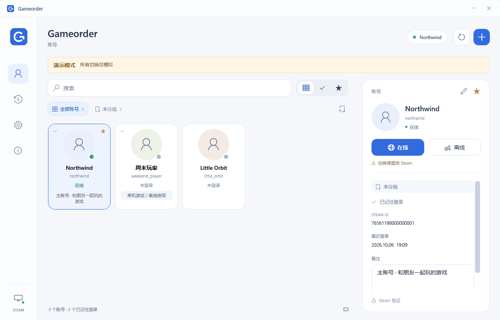
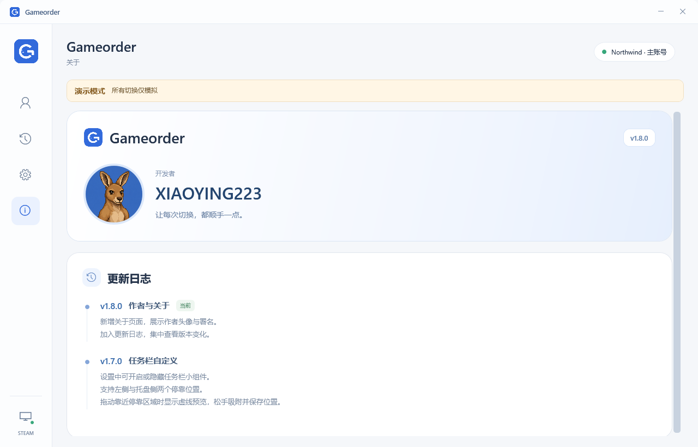

# Gameorder


让 Steam 多账号管理更顺手。Windows 桌面工具，使用头像卡片管理账号，通过任务栏小组件快捷切换。

**版本：1.8.0 · 作者：XIAOYING223**

## 功能

- 头像网格、备注、收藏与搜索，一眼找到目标账号。
- 软件内账号分组；添加账号、编辑昵称和备注、移出账号库。
- 在线／离线启动，并显示本机 Steam 当前账号和会话状态。
- 任务栏小组件：直接预览账号、展开头像栏并发起切换。
- 在设置中开关小组件；拖动至「左侧」或「托盘侧」，靠近落点时显示同尺寸圆角虚线框。
- 自定义标题栏、紧凑圆角托盘菜单，以及包含作者头像和更新日志的「关于」页。

## 界面预览

以下截图使用软件内的合成演示账号。





## 使用

下载并解压作者发布的 Windows x64 程序包，运行 `Gameorder.exe`。从源码构建的方法见下文。

1. 自动识别 Steam 路径；未识别时，在设置中选择 `steam.exe`。
2. 从 Steam 导入本机账号，或添加登录名作为待登录账号。
3. 选择头像，点击在线或离线操作，确认后由 Steam 完成登录。

切换会正常退出并重新启动 Steam，请先保存游戏进度。账号密码、Steam Guard 和首次授权都在 **Steam 官方窗口**中完成。离线模式要求该账号已在本机在线登录并保留有效登录缓存；失效授权和仅联网游戏仍需联网。

绿色状态表示本机 Steam 会话已确认在线；离线、等待登录和未知状态另行显示。工具不会把「有登录缓存」或「上次选择」直接当作在线。

关闭或最小化主窗口后，托盘和任务栏组件继续运行。完全退出请使用托盘菜单的「退出」。任务栏空位不足时组件会缩小或暂时隐藏；也可从托盘打开头像栏。

更多操作见 [使用说明](使用说明.md)。

## 本机数据

| 内容 | 默认位置 |
| --- | --- |
| 昵称、备注、分组、收藏、任务栏偏好与请求记录 | `%LOCALAPPDATA%\FloatOrder\accounts.json` |
| 公开头像缓存 | `%LOCALAPPDATA%\FloatOrder\avatars` |
| 切换前的加密配置快照 | `%LOCALAPPDATA%\Gameorder\backups` |

`FloatOrder` 是兼容旧版本而保留的数据目录名。Gameorder 不收集密码或验证码，也不导出或迁移 Steam 认证令牌。

头像优先使用 Steam 本机缓存；缺少时会通过账号的 SteamID 查询 Steam Community 公开资料并下载头像。请求不使用密码、令牌或登录 Cookie。服务限流或加载失败时保留缓存／占位，不阻止切换。使用 `Gameorder.exe --local-avatars` 可只加载本机头像。

切换备份由 Windows DPAPI 加密，同一 Windows 用户可在设置中恢复最近一次切换。Steam 未能正常退出、配置格式异常或配置被其他程序改动时，会停止修改或恢复并提示。

## 开发与构建

需要 Windows、.NET 9 SDK 和 Windows 桌面开发支持。项目使用 WPF，未依赖第三方 NuGet 包。已提交应用图标与作者头像，无需先运行图标生成脚本。

```powershell
dotnet build .\src\Gameorder.csproj -c Release
dotnet run --project .\tests\Gameorder.Tests.csproj -c Release
```

发布 Windows x64 单文件程序，包含 .NET 运行时：

```powershell
.\Build.ps1 -SelfContained
```

输出位于 `dist\`。不加 `-SelfContained` 可生成依赖本机 .NET Desktop Runtime 9 的程序目录；分发时应保留整个输出目录。

演示模式使用合成账号，不保存资料、不改 Steam 配置、不启动 Steam：

```powershell
.\dist\Gameorder.exe --demo
```

程序还提供 UI 验证入口，可在发布目录运行：

```powershell
.\dist\Gameorder.exe --ui-smoke .\verification\manager
.\dist\Gameorder.exe --quick-ui-smoke .\verification\quick
```

核心测试使用合成配置、模拟进程与模拟注册表，UI 验证通过演示模式渲染 WPF 界面。真实账号认证由用户在自己的 Steam 客户端完成。

## 发布与署名

更新记录见 [CHANGELOG](CHANGELOG.md)。准备上传 GitHub 时见 [上传说明](上传GitHub.md)，发布文案可使用 [Release 模板](docs/RELEASE_TEMPLATE.md)。仓库中不包含个人账号数据、构建产物或宣传视频。


作者 **XIAOYING223**。项目发布许可由作者确定，当前未附带开源许可证。

本工具为独立本地工具，与 Valve／Steam 无隶属关系。Steam 本机配置格式可能随客户端更新变化。
